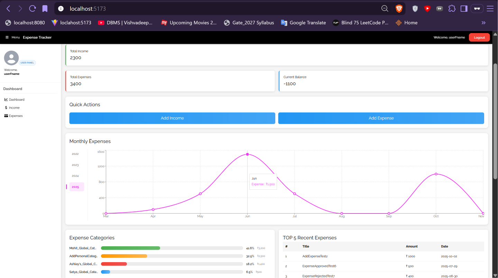
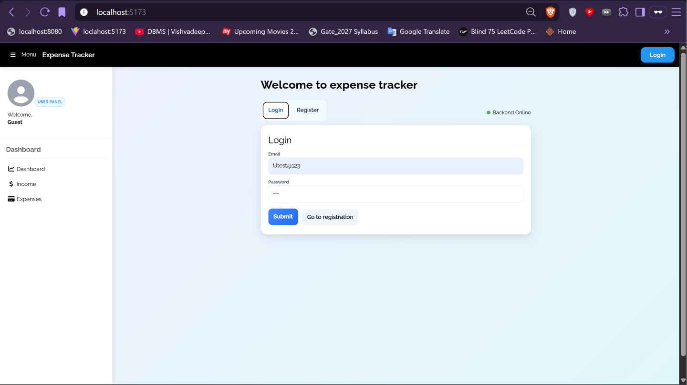
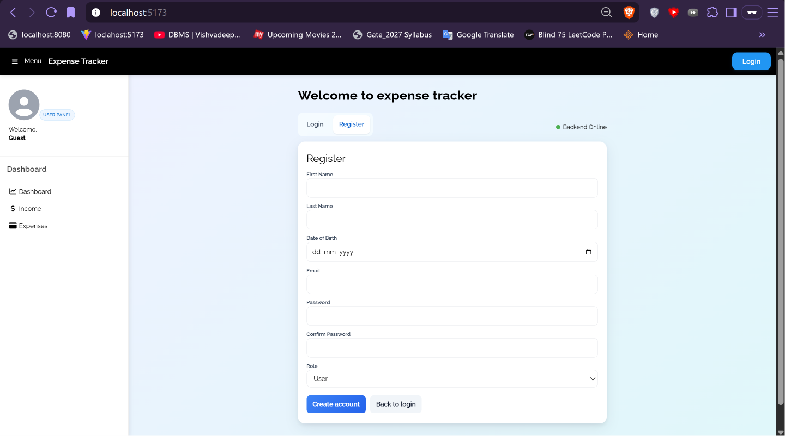
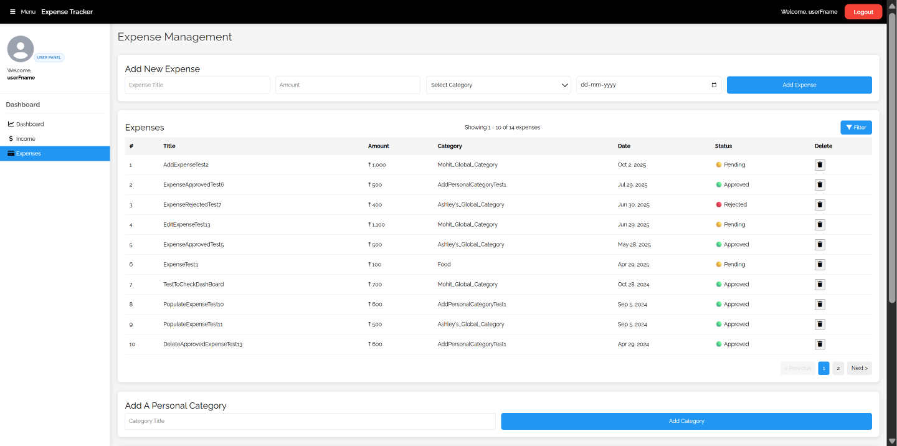
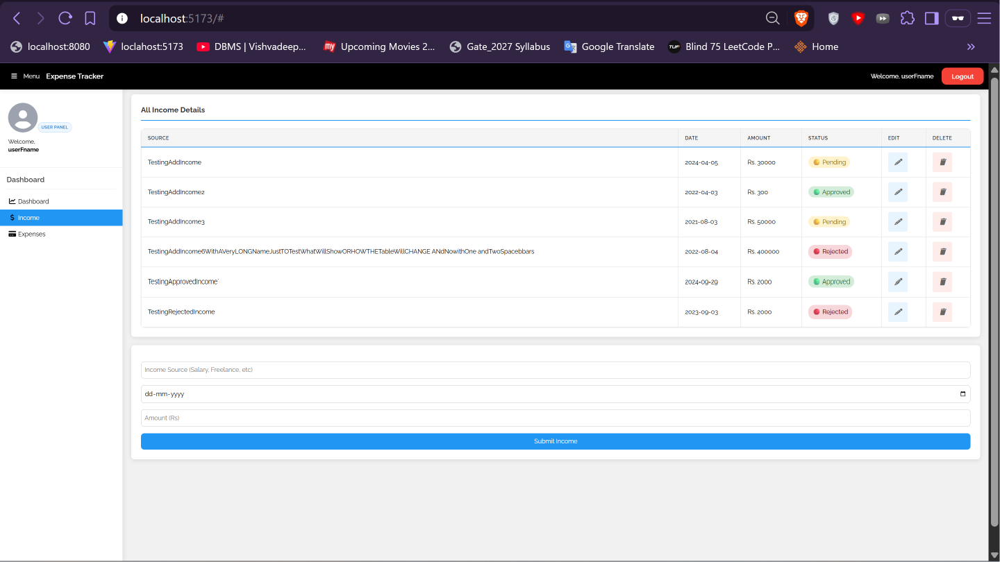
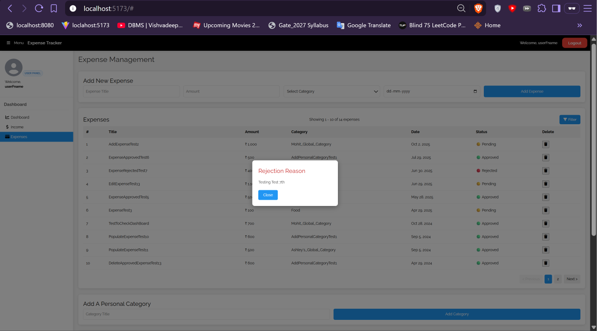
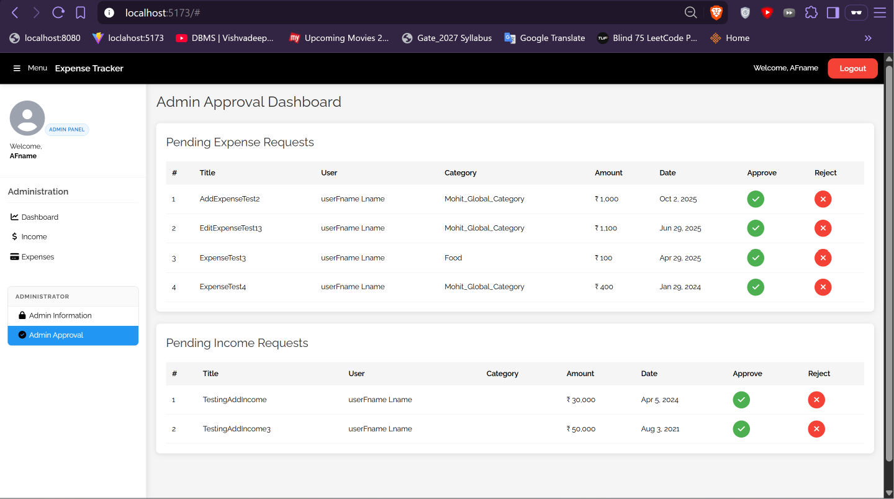
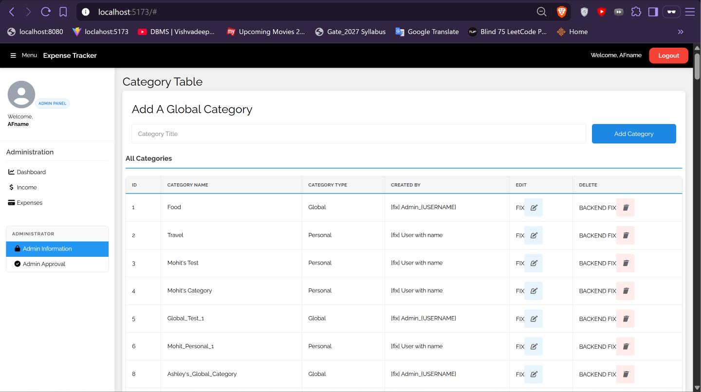

<div align="center">

# 💸 Expense Tracker

**A full-stack, role-based expense & income tracker with an admin approval workflow.**

Users log income and expenses → Admins review and approve or reject each entry (with a reason) → Approved entries feed the user's dashboard.




</div>

---

## 📌 Table of Contents

- [Features](#-features)
- [By the Numbers](#-by-the-numbers)
- [Tech Stack](#-tech-stack)
- [Screenshots](#-screenshots)
- [How It Works](#-how-it-works)
- [Project Structure](#-project-structure)
- [Getting Started](#-getting-started)
- [API Reference](#-api-reference)
- [Data Model](#-data-model)
- [Known Issues & Roadmap](#-known-issues--roadmap)
- [Author](#-author)

---

## ✨ Features

### 👤 User
- **Register / Login** with a live *Backend Online* health indicator
- **Dashboard**: total income, total expenses, current balance, a monthly expense line chart with year selector, category-wise breakdown and the top 5 recent expenses
- **Expenses**: add, delete, paginate (10 per page) and **filter** by status, category and date range; sort by date
- **Income**: add, edit and delete income entries
- **Approval status** on every entry: 🟡 Pending · 🟢 Approved · 🔴 Rejected, with a popup showing the admin's **rejection reason**
- **Categories**: use global categories or create your own **personal categories**
- **My Requests** page to track the status of submitted entries

### 🛡️ Admin
- **Approval dashboard** listing every user's pending expense and income requests
- **Approve ✅ / Reject ❌** (rejection requires a reason shown to the user)
- **Global category management** (add / edit / delete categories visible to all users)
- **User management**: list, search, sort, edit and delete users

---

## 📊 By the Numbers

| Metric | Count |
|---|---|
| REST endpoints across 5 controllers (User, Expense, Income, Category, Dashboard) | **35** |
| Admin-only endpoints (enforced with `@PreAuthorize` and URL rules) | **11** |
| Roles | **2** (`USER`, `ADMIN`) |
| Approval states per expense/income | **3** (Pending, Approved, Rejected) |
| JPA entities | **4** (User, Expense, Income, Category) |
| Backend layers | Controllers → **6** services → **4** repositories |
| DTOs (including 5 for the dashboard) | **13** |
| Dynamic filter options on the expense list | **5** (status, category, start date, end date, sort), paginated at 10 per page by default |
| React page views / components | **7** views / **11** components |
| Frontend API service modules | **7** |
| Commits | **27** |

---

## 🛠 Tech Stack

| Layer | Technology |
|---|---|
| **Frontend** | React 19, Vite 7, Axios, Recharts, CSS Modules, W3.CSS |
| **Backend** | Java 17, Spring Boot 3.5.4, Spring Web, Spring Data JPA (Hibernate), Spring Security, Bean Validation, Actuator, Lombok |
| **Database** | MySQL 8 |
| **Build tools** | Maven (wrapper included), npm |

---

## 📸 Screenshots

### Authentication
| Login | Register |
|---|---|
|  |  |

### User Panel
| Expenses | Income |
|---|---|
|  |  |

**Rejection reason popup**



### Admin Panel
| Approval Dashboard | Category Management |
|---|---|
|  |  |

---

## ⚙️ How It Works

```
┌────────────────────┐    REST + session cookie     ┌──────────────────────┐   JPA/Hibernate   ┌─────────────┐
│  React + Vite SPA  │ ───────────────────────────► │  Spring Boot API     │ ────────────────► │   MySQL     │
│  localhost:5173    │ ◄─────────────────────────── │  localhost:8080      │ ◄──────────────── │ expenseTrackerDB │
└────────────────────┘        (Axios, CORS)         └──────────────────────┘                   └─────────────┘
```

**Authentication.** Spring Security form login at `POST /login` creates a server-side session (`JSESSIONID` cookie). Passwords are hashed with **BCrypt**. The React app uses Axios with credentials enabled, and CORS is configured to allow `http://localhost:5173`. Role-based access (`USER` / `ADMIN`) is enforced with URL rules and `@PreAuthorize("hasRole('ADMIN')")` on admin endpoints.

**Approval workflow.**

```
User submits expense / income ──► PENDING ──► Admin reviews
                                               ├─ Approve ──► APPROVED
                                               └─ Reject (+ reason) ──► REJECTED
```

**Backend layers.** `controllers` (REST) → `Services` (business logic, analytics) → `Repositories` (Spring Data JPA) → `Entities`. DTOs separate API shapes from entities, and `ExpenseSpecification` powers the dynamic expense filters (status, category, date range) with pagination.

**Frontend.** A single-page app where `App.jsx` switches between pages (Auth, Dashboard, Income, Expenses, Admin, My Requests, Users) using state persisted in `localStorage`. Each page talks to the API through a thin service layer in `src/services`.

---

## 📁 Project Structure

```
expenseTracker/
├── expense-spring/                         # Spring Boot backend
│   ├── pom.xml
│   └── src/main/
│       ├── resources/application.properties
│       └── java/com/mohit/expense_backend/
│           ├── ExpenseBackendApplication.java
│           ├── controllers/                # User, Expense, Income, Category, Dashboard
│           ├── Services/                   # Business logic
│           │   └── ExpenseServices/        # ExpenseService, ExpenseAnalyticsService
│           ├── Repositories/               # Spring Data JPA repositories
│           ├── Entities/                   # User, Expense, Income, Category
│           │   └── Enums/                  # ApprovalStatus
│           ├── dto/                        # Request/response DTOs
│           │   └── DashboardDTOs/          # Monthly, yearly, category & recent-transaction DTOs
│           ├── Security/                   # SecurityConfig, UserPrincipal, CurrentUserService
│           ├── Specifications/             # Dynamic expense filtering
│           └── archives/seeders/           # Sample data seeder
│
├── expense-vite/                           # React frontend
│   ├── package.json
│   ├── vite.config.js
│   └── src/
│       ├── App.jsx                         # Page switching + current user
│       ├── axiosConfig.js                  # Axios instance
│       ├── components/                     # AuthPage, DashboardPage, ExpensePage, IncomePage,
│       │                                   # AdminPage, MyRequestsPage, UsersTable, Sidebar, Header...
│       └── services/                       # API clients (Expense, Income, Category, Dashboard, User, Admin)
│
├── screenshots/
└── README.md
```

---

## 🚀 Getting Started

### Prerequisites
- **Java 17**
- **Node.js 18+** and npm
- **MySQL 8** running locally
- Maven (or use the included `mvnw` wrapper)

### 1. Clone
```bash
git clone https://github.com/cmohit26/expenseTracker.git
cd expenseTracker
```

### 2. Create the database
```sql
CREATE DATABASE expenseTrackerDB;
```
Tables are created automatically by Hibernate (`ddl-auto=update`).

### 3. Configure the backend
Edit `expense-spring/src/main/resources/application.properties`:
```properties
spring.datasource.url=jdbc:mysql://localhost:3306/expenseTrackerDB
spring.datasource.username=<your_mysql_user>
spring.datasource.password=<your_mysql_password>
server.port=8080
```

> ⚠️ Use your own credentials and never commit real passwords. Prefer environment variables, e.g. `spring.datasource.password=${DB_PASSWORD}`.

### 4. Run the backend
```bash
cd expense-spring
./mvnw spring-boot:run        # Windows: mvnw.cmd spring-boot:run
```
API runs on **http://localhost:8080**. Health check: `GET /ping`.

### 5. Run the frontend
```bash
cd expense-vite
npm install
npm run dev
```
App runs on **http://localhost:5173**.

### 6. Try it out
1. Open http://localhost:5173 and go to **Register**.
2. Create one account with role **User** and another with role **Admin**.
3. As the user, add expenses/incomes. As the admin, approve or reject them from **Admin Approval**.

---

## 🔌 API Reference

Base URL: `http://localhost:8080` · Auth: session cookie (`JSESSIONID`) · 🔒 = login required · 🛡️ = admin only

### Auth & Users
| Method | Endpoint | Description |
|---|---|---|
| POST | `/v1/user` | Register a new user |
| POST | `/login` | Log in (Spring Security form login) |
| POST | `/logout` | Log out and invalidate session |
| GET | `/currentUser` | Get the logged-in user |
| GET | `/ping` | Health check |
| GET | `/v1/user/{id}` | Get a user by id |
| GET | `/v1/users` 🛡️ | List all users |
| GET | `/v1/users/search?search=` 🔒 | Search users |
| GET | `/v1/users/sortBy/{field}` 🔒 | Sort users by field |
| PUT / DELETE | `/v1/user/{id}` 🛡️ | Edit / delete a user |

### Expenses
| Method | Endpoint | Description |
|---|---|---|
| POST | `/v1/expense` 🔒 | Create an expense |
| GET | `/v1/expense` 🔒 | Paginated list. Params: `page`, `size`, `status`, `categoryId`, `startDate`, `endDate`, `sort` |
| GET | `/v1/expense/recent` 🔒 | Recent expenses |
| GET | `/v1/expense/{id}` 🔒 | Get one expense |
| PUT | `/v1/expense/{id}` 🔒 | Update an expense |
| DELETE | `/v1/expense/{id}` 🔒 | Delete an expense |
| GET | `/v1/expense/pending-expenses` 🛡️ | All pending expenses |
| PUT | `/v1/expense/approve-expense/{id}` 🛡️ | Approve |
| PUT | `/v1/expense/reject-expense/{id}` 🛡️ | Reject. Body: `{ "reason": "..." }` |

### Income
| Method | Endpoint | Description |
|---|---|---|
| POST | `/v1/income` | Add income |
| GET | `/v1/income/me` | My incomes |
| PUT | `/v1/income/{incomeId}` | Update income |
| DELETE | `/v1/income/{incomeId}` | Delete income |
| GET | `/v1/income/pending-incomes` 🛡️ | All pending incomes |
| PUT | `/v1/income/approve-income/{id}` 🛡️ | Approve |
| PUT | `/v1/income/reject-income/{id}` 🛡️ | Reject. Body: `{ "reason": "..." }` |

### Categories
| Method | Endpoint | Description |
|---|---|---|
| POST | `/v1/category` | Create a category |
| GET | `/v1/category/user/all` | Categories of the current user |
| GET | `/v1/category/user/available` | Categories available to the current user (global + personal) |
| GET | `/v1/category/admin/all` 🛡️ | All categories |
| GET | `/v1/category/admin/global` 🛡️ | Global categories |
| PUT / DELETE | `/v1/category/{id}` | Update / delete a category |

### Dashboard
| Method | Endpoint | Description |
|---|---|---|
| GET | `/v1/dashboard` 🔒 | Totals, monthly/yearly expense data, category breakdown, recent transactions |

---

## 🗄 Data Model

```
users ─────────┬──< expense >──── category
 id            │     id, title, amount, date,
 first_name    │     status, rejectionReason,
 last_name     │     user_id, category_id
 date_of_birth │
 email (unique)└──< income
 password (BCrypt)     title/source, amount, date,
 roles                 status, rejectionReason, user_id
```

`ApprovalStatus` (enum): `PENDING` · `APPROVED` · `REJECTED`

---

## 🧭 Known Issues & Roadmap

- [ ] Category table shows `[fix]` placeholders for *Created By*, and edit/delete buttons are marked for fixing
- [ ] Restrict the **Admin** role at registration (currently selectable by anyone)
- [ ] Move secrets out of the repo (DB password, `.env`) and use environment variables
- [ ] Protect `/v1/income/**` and `/v1/category/**` at the URL level, not only in services
- [ ] Add unit and integration tests
- [ ] Export reports (CSV / PDF)
- [ ] Budget limits and alerts
- [ ] Dockerize the full stack (backend, frontend, MySQL)

---

## 👨‍💻 Author

**Mohit** · [@cmohit26](https://github.com/cmohit26)

⭐ If you find this project useful, consider giving it a star!
